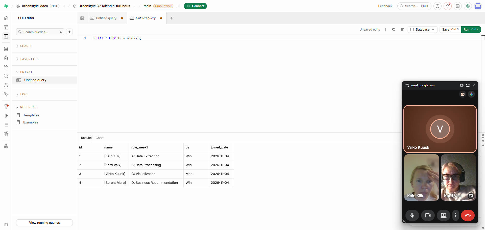

# Week 0 – individuaalne töö
## Minu roll tiimis
Roll B – Data Processing / Supabase seadistamine

Minu ülesanne oli seadistada tiimi ühine Supabase keskkond ja kontrollida, et andmebaas töötab korrektselt.

## Tehtud tegevused
Seadistasin tiimi ühise Supabase projekti.
Kutsusin projekti tiimiliikmed.
Seadistasin andmebaasi parooli ja salvestasin selle turvaliselt paroolihaldurisse.
Lõin team_members tabeli.
Lisasin tabelisse kõik 4 tiimiliiget koos nende Week 1 rollide ja operatsioonisüsteemidega.
Kontrollisin tabeli sisu SQL-päringuga:
SELECT * FROM team_members;

Kontrollisin liikmete nimesid ja rolle SQL-päringuga:
SELECT name, role_week1 FROM team_members ORDER BY name;

Mõlemad päringud töötasid korrektselt ja tagastasid 4 tiimiliiget.

## Tulemus
Tiimi ühine Supabase keskkond on seadistatud ning team_members tabel ja SQL-päringud töötavad.

## Tõendus
Supabase seadistuse ja töötava SQL-päringu ekraanipilt:

